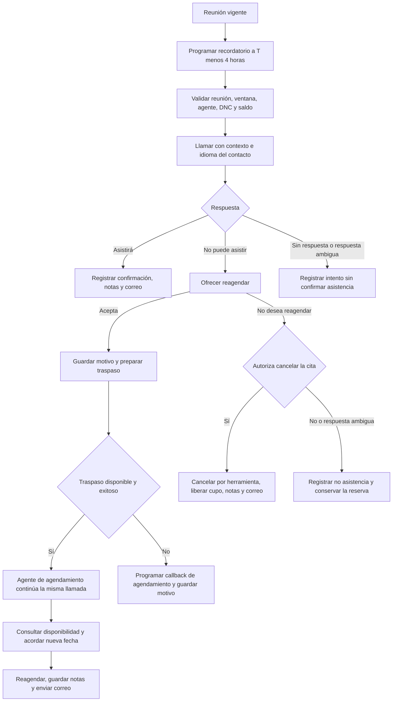

# Seguimiento automático completo en Organization

Propuesta de producto e implementación · 1 de noviembre de 2026

Revisión de alcance y experiencia · 2 de noviembre de 2026

Estado (6 de noviembre de 2026): Step 0 y Stages 1–3 implementados detrás del piloto;
ver §16–§19 para el alcance comprobado y la validación real pendiente. La
propuesta restante no está implementada. Basado
en el código actual y en la
[propuesta de activación rápida](PLAN_IA_VOICE_AGENTS_QUICK_ACTIONS.md), cuyas
automatizaciones ya están parcialmente implementadas. Este documento define la
siguiente entrega: la llamada fría humana entrega el seguimiento a la IA, que
gestiona el siguiente paso, agenda, confirma, reagenda y cierra el trabajo, con
contexto, idioma, registro y medición desde el primer piloto.

Lectura por propósito: la meta y el recorrido están en §1–§6; la experiencia de
pantallas y conversación, en §14; arquitectura, reglas y entregas, en §11–§13.
La tabla de §15 verifica cada observación incorporada de la revisión.

## 1. Resultado esperado y decisiones confirmadas

**Meta de producto: los humanos se concentran en llamadas frías y captación de
clientes; los AI Voice Agents ejecutan el seguimiento completo.** El vendedor
registra el resultado de su conversación y continúa con la siguiente oportunidad.
No tiene que elegir un agente, crear otro callback ni comprobar cada intento.

La experiencia se presenta como **Seguimiento automático**. Los dos agentes
son especialistas editables dentro de esa capacidad. La promesa visible es:
«Tu equipo encuentra oportunidades. Ringee se encarga de darles seguimiento».

Al activar el plan Organization, un workspace nuevo recibe dos capacidades encendidas
por defecto: **Recordatorios y confirmaciones** y **Agendar citas**. Los agentes
trabajan sobre los mismos contactos, llamadas, notas, callbacks y reuniones que
el equipo humano. Cada intervención queda identificada como realizada por IA.

| Responsabilidad                                                                                           | Quién la ejecuta                                                     |
| --------------------------------------------------------------------------------------------------------- | -------------------------------------------------------------------- |
| Prospectar en frío, identificar oportunidades y captar clientes                                           | Equipo humano                                                        |
| Retomar el compromiso acordado, devolver llamadas y ofrecer el siguiente paso                             | IA, con información y objetivos autorizados por la empresa           |
| Agendar, confirmar, reagendar, cancelar con autorización y recuperar intentos fallidos                    | IA                                                                   |
| Notas, resultados, correos y trazabilidad                                                                 | Ringee automáticamente                                               |
| Configuración, saldo, solicitud expresa de una persona o decisión comercial fuera del alcance configurado | Responsable de excepción; nunca una devolución rutinaria al vendedor |

«Seguimiento completo» incluye resolver o cerrar cada solicitud con un resultado
real, incluso «sin respuesta» o «no desea continuar». No significa insistencia
indefinida ni declarar una venta porque se consiguió una reunión. Precios, acuerdos
y compromisos que la empresa no haya autorizado requieren una decisión excepcional.

Decisiones del usuario:

- Mantener el cobro actual por **tokens y minutos consumidos**, con los mecanismos
  de facturación y créditos existentes. No introducir una bolsa de minutos ni
  cambiar tarifas como parte de esta entrega.
- La vía principal para reagendar es **transferir la misma llamada** al agente
  de agendamiento. Si no es posible o falla, **programar un callback para el
  agente de agendamiento** y guardar el motivo en la llamada y en el contacto.
- Intentar confirmar cada reunión cuatro horas antes; proponer reagendar si la
  persona no puede asistir y transferir cuando acepte.
- Dar a cada agente contexto del contacto y sus llamadas recientes, utilizando
  el idioma de la última conversación con ese contacto.
- Guardar los resultados y enviar correo cuando se confirma, agenda, reagenda o
  se informa que no asistirá y no desea reagendar.
- Permitir personalizar los agentes y apagar o encender sus triggers.
- Entregar automáticamente a la IA los nuevos seguimientos elegibles de las
  llamadas humanas cuando el workspace tenga habilitada esta capacidad.
- Mantener a la IA como ejecutora durante fallos recuperables; las excepciones
  reales se dirigen a quien pueda resolverlas, con contexto y una acción concreta.

**Ajustes de esta revisión:** activación explícita para organizaciones existentes;
traspaso breve sin cambio de voz obligatorio; callback que sobrevive a la cita
original; cancelación por autorización del contacto; visibilidad del responsable;
métricas desde el piloto; correo sin CC masivo; continuidad al devolver una llamada.
Los defaults de cadencia y los cambios de reglas siguientes son propuestas para
esta implementación, no comportamiento que ya exista en producción.

La activación predeterminada expresa la configuración deseada. Para poder llamar
deben estar listos el número, calendario, agente, permisos y saldo. Si falta algo,
la tarjeta muestra **Necesita configuración** y una acción concreta para resolverlo.

## 2. Base existente y brechas comprobadas

| Área          | Qué existe hoy                                                                            | Qué completar                                                                                                       |
| ------------- | ----------------------------------------------------------------------------------------- | ------------------------------------------------------------------------------------------------------------------- |
| Triggers      | `VoiceAgentAutomationService`, tarjetas y pausa por capacidad, detrás de un flag piloto   | Aprovisionamiento al activar Organization y persistencia de preferencias frente a renovaciones                      |
| Recordatorios | Políticas por calendario y ejecuciones durables, con versión y deduplicación              | Default de 240 minutos; cobertura automática de calendarios y política para reuniones creadas con poca anticipación |
| Confirmación  | `confirm_meeting_attendance`, estado de asistencia separado del estado de reunión         | Continuación hacia reagendamiento y cierre estructurado del seguimiento                                             |
| Agendamiento  | `get_available_slots`, `book_appointment`, reservas protegidas contra solapamiento        | Herramienta de reagendamiento seguro de la reunión existente                                                        |
| Traspaso      | Transferencias de recepcionista a personas/grupos/extensiones                             | Handoff IA → IA; la interfaz neutral del proveedor todavía no lo expone                                             |
| Contexto      | Tres llamadas previas y llamada de origen, con resúmenes acotados en las acciones rápidas | Contexto común para todas las llamadas IA, notas, compromisos y consulta autorizada de detalles                     |
| Idioma        | Voz e instrucciones configuradas por agente; idioma almacenado en transcripción/análisis  | Selección fiable por conversación, sin cambiar globalmente el agente entre llamadas concurrentes                    |
| Callbacks     | Programación durable; vuelve a llamar el agente que originó el callback                   | Destino explícito al agente de agendamiento, motivo y tarea de reagendamiento                                       |
| Historial     | `Call` y `AiVoiceAgentCall`, resultados, transcripción y costos                           | Participaciones de varios agentes, notas atribuidas a IA y eventos de negocio consistentes                          |
| Correo        | `MeetingEmailService` y `MeetingEmailDelivery` para asistencia confirmada/rechazada       | Agenda, reagenda, callback de recuperación y comprobante al contacto cuando declina                                 |
| Medición      | Actividad básica de automatizaciones e infraestructura de dashboard                       | Embudo por agente y trigger, resultados verificados y costos sin duplicación                                        |

Dos dueños adicionales pasan a ser parte del alcance:

- `DispositionService`/`OUTCOME_BEHAVIOUR`, `MeetingService.updateCallOutcome`,
  callbacks y colas de campaña/`my-day`: hoy el resultado humano puede generar
  trabajo humano. Debe asignarse un único ejecutor y evitar llamadas duplicadas.
- `PendingActionService`/`PendingActionRepository` y el pipeline de recomendaciones:
  ya poseen las acciones de seguimiento. Extender esa responsabilidad con ejecución
  y objetivos durables; no crear un segundo centro de tareas ni ejecutar todas las
  recomendaciones históricas solo porque siguen en estado `pending`.

Detalles relevantes: el formulario propone hoy 24 horas; `AiVoiceAgentCall.callId`
y `providerConversationId` son únicos; los callbacks heredan el agente y las
variables de la llamada original. La regla actual de correo avisa al equipo,
pero no al contacto, cuando este no asistirá.

## 3. Activación nativa y control del usuario

El [plan específico de Stage 4 con PostHog](PLAN_ORGANIZATION_STAGE_4_POSTHOG.md)
detalla aprovisionamiento, onboarding, eventos, medición y despliegue gradual.

1. Reconciliar la suscripción Organization y su asociación al workspace. Hoy
   intervienen los webhooks de Stripe y Clerk: deben soportarse ambos órdenes
   de llegada y sus reintentos.
2. Extender `VoiceAgentAutomationService` para crear o reutilizar los dos agentes
   y sus triggers una sola vez por organización. Reutilizar los claims existentes.
3. Resolver el calendario global mediante `CalendarService`; usar las políticas
   existentes por calendario. En organizaciones nuevas, cubrir los calendarios
   activos actuales y futuros compatibles con la empresa/número configurados,
   permitiendo exclusiones explícitas por calendario. Si uno pertenece a otra marca
   o necesita otra configuración, mostrar el dato faltante antes de llamar; no
   heredar silenciosamente una identidad comercial incorrecta.
4. Usar el número ya asignado o el único número utilizable. Si hay varios y ninguno
   está asignado, pedir la selección en onboarding, según AGENT-008.
5. Precargar nombre, empresa, voz compatible, horario y offset de cuatro horas.
   Mantener el editor avanzado para instrucciones, saludo, voz y demás opciones.
6. Mostrar en el onboarding qué resultados humanos iniciarán seguimiento, qué
   calendario/número se usarán, la confirmación a cuatro horas y el consumo por
   tokens/minutos. Usar `OrganizationUpgradePanel` para la presentación del plan.
7. Mostrar alcance, horario y estado en una sola pantalla; pedir solo los datos
   que faltan. Voz, prompt, modelo y preferencias avanzadas viven en Personalizar.
   La preparación de agentes no obliga al usuario a permanecer en esa pantalla.

Persistir el origen y la versión de aprovisionamiento, además de la decisión del
administrador. Una renovación, reconexión, retry o reconciliación **no vuelve a
encender** un trigger apagado ni recrea uno que se eliminó deliberadamente.
La eliminación necesita conservar esa preferencia aunque desaparezca la tarjeta.

Para organizaciones existentes: ofrecer **Activar seguimiento automático** con
una vista previa de alcance y consumo. No iniciar llamadas retroactivamente por
desplegar una migración. Tras esa elección, migrar por lotes idempotentes,
reutilizando configuraciones y agentes sin sobrescribir nombres, instrucciones,
offsets, exclusiones ni pausas. Los callbacks y seguimientos humanos existentes
conservan su ejecutor; transferirlos a IA exige una acción explícita sobre su alcance.

Apagar un trigger impide nuevos intentos automáticos y nuevos traspasos asociados;
retira ejecuciones pendientes y pausa sus callbacks de recuperación. Antes de
aplicar la pausa, mostrar cuántos compromisos quedarán detenidos y a qué afecta.
No convertirlos silenciosamente en tareas humanas ni afirmar que siguen activos.
Las llamadas
ya iniciadas pueden terminar, guardar resultados y liquidar consumo. Los correos
ya debidos por resultados válidos deben conservar su entrega, salvo que el evento
haya quedado obsoleto. Reanudar replantea solo acciones futuras válidas y muestra
los compromisos vencidos; nunca provoca una ráfaga de llamadas atrasadas.
Separar pausa global, pausa del especialista y pausa de un contacto. Una toma de
control humana detiene atómicamente la continuación IA de ese caso; no se reanuda
hasta que se devuelva explícitamente a IA o un resultado válido cierre la tarea.

El aprovisionamiento nativo requiere la suscripción correspondiente. La política
de suspensión debe seguir el estado y vigencia efectivos del plan; programar una
cancelación a fin de período no equivale a perder el acceso inmediatamente. No
cambiar silenciosamente el acceso histórico de agentes avanzados por introducir
este aprovisionamiento. Conservar historial y preferencias al terminar el plan.

## 4. De la llamada fría al seguimiento resuelto

### 4.1. Entrega automática en el cierre habitual de la llamada

Usar la transición persistida del resultado canónico, no el nombre editable de una
disposition. La política de Organization y la evidencia de la conversación deciden
el siguiente paso. No pedir que el vendedor vuelva a configurarlo en otra pantalla.

| Resultado humano                               | Trabajo que toma la IA                                                                                                         | Texto al guardar                              |
| ---------------------------------------------- | ------------------------------------------------------------------------------------------------------------------------------ | --------------------------------------------- |
| Interesado / seguimiento con objetivo válido   | Retomar el interés, resolver consultas con información aprobada y buscar el siguiente paso acordado; agenda cuando corresponda | «La IA se encarga del seguimiento»            |
| Callback acordado                              | Llamar a la hora acordada con el propósito y contexto originales                                                               | «La IA llamará el martes a las 10:00»         |
| Reunión creada                                 | Llamar para confirmar a cuatro horas, gestionar cambios y cerrar el resultado                                                  | «La IA llamará para confirmar esta reunión»   |
| No interesado / no desea continuar             | Cerrar este seguimiento; si pide no recibir llamadas, aplicar DNC y retirar intentos relacionados                              | «Seguimiento cerrado»                         |
| Venta registrada                               | Resolver el objetivo comercial; continuar solo un compromiso posterior explícito                                               | «Objetivo completado»                         |
| Número incorrecto                              | Detener marcado y aplicar las reglas existentes; no insistir al mismo número                                                   | «Número excluido del seguimiento»             |
| Sin respuesta / buzón durante prospección fría | Mantenerlo en el proceso humano de prospección según sus reglas                                                                | No inventar interés ni iniciar prospección IA |

Usar fechas, objetivo y compromisos ya registrados en la llamada. Si se extrajeron
del análisis, mostrarlos en el cierre normal para corregirlos cuando estén presentes;
el resultado explícito de la persona tiene prioridad. No esperar un análisis tardío
para avanzar el dialer ni inventar que una hora fue acordada. Un callback sin hora
confiable queda como seguimiento con horario de política, claramente identificado,
hasta que se obtenga un acuerdo concreto.

Esto requiere un contrato explícito de **seguimiento automático** en el cierre,
no omitir la fecha exigida por los endpoints actuales de callback. Un callback
acordado conserva su validación de fecha; el seguimiento sin acuerdo guarda el
objetivo y su próxima ejecución calculada por política. Las superficies antiguas
mantienen sus requisitos. El wrap-up solo avanza cuando el resultado y la
continuación correspondiente fueron aceptados durablemente.

En modo automático, la política puede definir como objetivo inicial de un resultado
«Interesado» ofrecer una cita. No significa que ya exista una reserva ni permiso
para inventar compromisos. Un objetivo distinto —por ejemplo, aclarar una duda
antes de agendar— se conserva; no forzar todas las conversaciones a una cita.

La asignación de especialista y modo se decide en servidor desde el objetivo:

| Objetivo                                                                          | Especialista y modo                 |
| --------------------------------------------------------------------------------- | ----------------------------------- |
| Retomar interés, aclarar una consulta autorizada o cumplir un callback comercial  | Agendar citas, modo **Seguimiento** |
| Conseguir una fecha nueva                                                         | Agendar citas, modo **Agendar**     |
| Cambiar una cita                                                                  | Agendar citas, modo **Reagendar**   |
| Entregar información de una reunión y registrar asistencia/cancelación autorizada | Recordatorios y confirmaciones      |

Extender el blueprint de agendamiento con esos modos, sin crear otro agente que
el cliente tenga que configurar. En **Seguimiento**, la conversación persigue el
objetivo guardado; solo ofrece una cita cuando corresponde. Una herramienta de
resultado de seguimiento registra la respuesta explícita, evidencia de la llamada
y próximo paso o cierre. Un objetivo informativo puede resolverse cuando la persona
confirma que recibió la información requerida, sin fabricar `meeting_booked`.
Si necesita algo fuera del conocimiento o facultades autorizadas, permanece sin
resolver y se deriva a una excepción. El modo, objetivo y herramientas permitidas
se validan en servidor; ni el prompt ni un argumento libre del modelo los amplían.

La asignación se guarda con la misma transición, o con una obligación durable
reconciliable, y deduplica por llamada y revisión del resultado. Hasta entonces la
interfaz dice «Preparando seguimiento», no «La IA se encarga». Una corrección humana
invalida la acción pendiente anterior antes de despachar otra.

El lead sale de las colas automáticas/manuales de prospección que puedan duplicar
ese trabajo cuando la IA asume el seguimiento. Solo un ejecutor puede reclamar la
próxima acción. Mantener `CALL-013`, comportamiento canónico y coordinación de
campañas; no reencolar para el vendedor un callback que ya ejecutará IA.

### 4.2. La tarea persiste; llamadas y callbacks son pasos

Extender las acciones existentes con objetivo, llamada/origen, contacto, marca,
responsable comercial, ejecutor, estado de ejecución, próxima acción, horario,
límites, evidencia y motivo de cierre. Cada tarea activa tiene una próxima acción
o una razón explícita de espera; programar o marcar un callback no la completa.

Estados de producto: **Programado**, **En curso**, **Esperando respuesta**,
**Recuperando un error**, **Pausado**, **Bloqueado**, **Resuelto** y **Cerrado**.
El cierre distingue rechazo, no contacto, agotamiento de intentos y cancelación.
Son estados propuestos de ejecución; no renombrar los enums públicos actuales.

Crear la cita resuelve el objetivo de agendamiento y enlaza su confirmación futura.
Confirmar resuelve esa verificación, no prueba asistencia real. Tras una reunión,
un próximo paso explícito registrado por el equipo o una fuente autorizada puede
abrir otra continuación IA. No adivinar qué ocurrió en una reunión externa ni
cerrar una oportunidad como ganada por inferencia del agente.

### 4.3. Confirmación de la reunión a cuatro horas

El recordatorio pregunta por la asistencia; no supone que una llamada contestada
equivale a confirmación. Si la persona no puede, ofrece una alternativa de manera
amable. Si rechaza reagendar o pide terminar, respeta la decisión.

Ejemplo de continuidad:

> Recordatorios: «Entiendo que hoy no podrás. ¿Quieres que busquemos otra fecha?»
>
> Contacto: «Sí, preferiblemente mañana por la tarde».
>
> Recordatorios: «Te voy a transferir con el agente que organiza las citas. Ya le
> pasaré que necesitas mover la reunión de hoy y que prefieres mañana por la tarde».
>
> Agendamiento: «Hola, Ana. Me transfirió el agente de recordatorios porque no
> podrás asistir hoy. Voy a revisar los horarios disponibles para mañana por la tarde».

El segundo agente entra en modo **reagendar una reunión existente**, conserva al
responsable y el calendario, y pregunta únicamente por información que falta.
Para una cita nueva sigue usando el modo de agendamiento. Los triggers operan sobre
eventos nuevos elegibles; habilitar la capacidad no marca de golpe contactos
históricos ni convierte la lista de prospección fría en una campaña IA.

El traspaso se anuncia una vez y conserva idioma, información y compromisos.
Mantener la voz cuando ayude a la continuidad; cambiarla es una preferencia de la
empresa, no un requisito para demostrar que intervino otro especialista. No repetir
identificación ya validada ni un discurso completo de presentación.

## 5. Tiempo, reintentos y casos límite

- **Cuatro horas** es el objetivo de programación, no una garantía de ejecución
  al segundo: el worker tiene cadencia, puede haber llamadas activas y aplican
  las ventanas autorizadas. Persistir UTC y presentar la zona IANA del contacto
  y la reunión; resolver diferencias de zona antes de anunciar una hora.
- Si T−4h cae fuera de ventana, conservar la regla existente AGENT-019 de
  adelantar a una hora permitida. Mostrar la hora real planificada y el motivo.
- Propuesta para una reunión creada o movida cuando faltan menos de cuatro horas:
  una confirmación anticipada tan pronto como permita la ventana, solo si aún
  quedan al menos 20 minutos. No llamar con menos de 15 minutos. Esta excepción
  necesita extender deliberadamente AGENT-019, que hoy omite offsets vencidos.
- Si la persona ya confirmó esa versión de la reunión, no repetir la llamada.
  Agendar una cita no debe marcar automáticamente su asistencia como confirmada.
- Un cambio de fecha invalida la confirmación y los intentos antiguos; se planifica
  el recordatorio correspondiente a la nueva versión.
- Sin respuesta: conservar el objetivo y aplicar la cadencia definida abajo.
  Agotar intentos cierra como **Sin respuesta**, sin marcar éxito ni crear por
  defecto una tarea para que el vendedor repita las llamadas.
- No llamar a una persona que ya está en otra llamada del workspace. Mantener
  DNC, saldo, elegibilidad del número y controles actuales de marcado.

Defaults propuestos para el piloto, visibles y editables por el administrador:

| Tipo de continuación              | Política inicial                                                                                                                                       |
| --------------------------------- | ------------------------------------------------------------------------------------------------------------------------------------------------------ |
| Seguimiento sin hora prometida    | Primer intento en la siguiente ventana hábil del día siguiente; hasta 3 intentos en 7 días, como máximo 1 al día                                       |
| Callback acordado                 | Respetar fecha/hora; si no responde, continuar con la política de seguimiento sin afirmar que se acordaron nuevos horarios                             |
| Recordatorio sin respuesta        | Un intento a T−4h y como máximo otro 60 minutos después, si aún quedan 20 minutos, está dentro de ventana y no hubo respuesta válida                   |
| Interrupción con tarea abierta    | Conciliar primero que terminó la llamada; recuperar en la próxima ventana con al menos 60 minutos de separación, salvo hora solicitada por el contacto |
| Incertidumbre de marcado/traspaso | Conciliar; no volver a llamar hasta saber que no hay una conversación activa                                                                           |

Una reserva común por contacto/workspace y un límite propuesto de 2 llamadas
automáticas al día coordinan recordatorios, seguimientos y recuperación; una hora
adicional expresamente solicitada por el contacto es una excepción registrada.
Priorizar el compromiso acordado y agrupar motivos compatibles en una conversación.
Un traspaso dentro de la misma llamada no es un segundo intento. Crear un callback
o cambiar de agente no reinicia los contadores del mismo seguimiento.

No confundir reintentos de contacto con retries técnicos: estos últimos conservan
las claves de idempotencia y solo repiten un marcado si se prueba que no se colocó.
No existe una garantía de llamada en una hora que quede fuera de ventana o sin
saldo; registrar el impedimento y no prometerla. El administrador ve controles de
consumo opcionales con pausa explícita y efecto sobre compromisos; no cambia el
cobro por tokens/minutos ni se enciende una recarga de saldo automáticamente.

## 6. Traspaso real y callback de recuperación

Telnyx documenta handoff entre asistentes dentro de una conversación y conservación
del contexto, con voz unificada o distinta. Proponemos transición anunciada y
breve, sin cambio de voz obligatorio; validar compatibilidad con el idioma elegido.
La capacidad documentada no prueba que el flujo saliente actual de Ringee ya
la soporte. [Documentación oficial de Agent Handoff](https://developers.telnyx.com/docs/inference/ai-assistants/agent-handoff).

Antes de implementar el resto del traspaso, hacer una prueba técnica controlada
del recorrido saliente real: recordatorios → agendamiento, identidad de las
herramientas, variables, eventos, transcripción, insights y consumo. Mantener la
operación dentro de `@ringee/platform` mediante una capacidad neutral del adapter.

Ringee persiste antes del traspaso: llamada raíz, contacto, reunión y versión,
agente origen, destino autorizado, razón, idioma, responsable, preferencias de
horario, resumen y acciones ya realizadas. El destino se resuelve en servidor a
partir del trigger de agendamiento de esa organización; no lo decide un ID libre
producido por el modelo.

Estados observables del traspaso: solicitado, preparando, completado, fallido o
pendiente de conciliación. El especialista solo puede usar herramientas de escritura
cuando su participación ha sido autorizada; la participación saliente deja de poder
modificar la cita. Evitar ciclos y limitar inicialmente a un traspaso recordatorios
→ agendamiento por intento.

Si no se puede transferir o se confirma un fallo:

1. Ofrecer que el especialista devuelva la llamada y acordar una hora concreta
   con la persona, respetando su zona y la ventana de llamadas. No prometer el
   callback antes de que se haya podido guardar.
2. Crear un callback durable **dirigido al agente de agendamiento**, ligado a la
   reunión y a la solicitud de reagenda. Conservar el agente de origen como evidencia.
3. Guardar en llamada y contacto la razón: destino no disponible, error de traspaso
   u otra causa normalizada, además de lo que pidió la persona y la hora acordada.
4. Confirmar el callback verbalmente solo después de persistirlo; enviar el
   comprobante por correo y mostrarlo en la cola normal de callbacks.
5. Al ejecutarlo, reconstruir contexto e idioma y comprobar que **la solicitud**
   sigue pendiente. La fecha pasada de la reunión original no la resuelve ni la
   cancela. Si otra interacción ya completó el objetivo, retirar el callback.

Ante un resultado incierto, conciliar primero el traspaso: no iniciar un callback
mientras otro agente podría estar hablando con el contacto. Si se corta la llamada
antes de acordar una hora, **la IA conserva el trabajo** y programa una recuperación
con la política autorizada; identificarla como intento de recuperación, no como
callback acordado. Si el agente está apagado, la tarea queda pausada con el motivo
visible; no se reactiva contra la preferencia del administrador ni se convierte
automáticamente en una llamada manual del vendedor.

Si hay saldo insuficiente, número inutilizable o credenciales inválidas, avisar al
administrador y retener el objetivo. Al resolverlo, revalidar y reprogramar con la
cadencia vigente. Una interrupción técnica recuperable no cuenta como excepción
humana. La UI muestra qué hará Ringee después, sin exponer códigos del proveedor
al contacto.

Extender `CallbackService` y su persistencia, manteniendo el comportamiento de
callbacks antiguos y humanos. No reutilizar sin cambios las variables del agente
de recordatorios: el callback de agendamiento necesita propósito de reagenda.

### 6.1. Cuando el contacto devuelve la llamada

Completar seguimiento incluye poder retomar una llamada perdida. Extender el
routing/recepcionista existentes para reconocer una tarea pendiente autorizada,
identificar al contacto sin revelar datos a otra persona y entregar la conversación
al especialista con el mismo contexto. Si hay varias tareas, preguntar brevemente
por cuál llama. Pausar el intento saliente mientras esa continuación está activa.

No exigir al usuario configurar un tercer agente para este recorrido: preparar
la recepción mínima mediante el mecanismo existente y mostrar el destino entrante
del número en onboarding. Conservar la selección de números y rutas del workspace;
un número con ruta humana existente solo cambia por elección del administrador.
Los especialistas siguen sin ser destinos entrantes directos generales.

Si el número elegido no permite devolver llamadas o mantiene una ruta incompatible,
mostrar **Devolución de llamadas pendiente de configurar** y la solución; no
presentar ese workspace como completamente autónomo. La recepción general de la
empresa queda fuera de este cambio: se añade continuidad del seguimiento, no un
rediseño de toda la central telefónica.

## 7. Contexto completo e idioma por contacto

Extender el actual `VoiceAgentConversationContextService` y aplicarlo desde los
puntos canónicos de inicio de conversación y de traspaso, incluyendo llamadas
manuales IA, API/MCP/CLI, callbacks y agentes entrantes cuando corresponda.

El contexto inicial incluye:

- Identidad, empresa, teléfonos y correo, zona horaria, idiomas registrados,
  etiquetas, campos personalizados pertinentes y responsable del contacto.
- Notas relevantes, compromisos abiertos, callbacks, reuniones vigentes y motivo
  exacto por el que se llama ahora.
- Últimas llamadas humanas e IA: fecha, resultado, resumen, objeciones y acuerdos;
  incluir siempre la llamada que originó la reunión o el seguimiento.
- Agente que transfirió, motivo, información ya confirmada y acciones persistidas
  durante la conversación actual.

Propuesta inicial: cinco llamadas recientes más la llamada de origen, con un
resumen acotado y acceso por herramienta a detalles adicionales autorizados.
«Contexto completo» significa poder consultar la información necesaria; no volcar
todo el historial ni truncar silenciosamente un compromiso importante. Si no hay
resumen, usar los hechos almacenados y marcar la información ausente.

Aplicar ownership, filtros de miembro y separación de marca en cada consulta,
incluidas notas y transcripciones. La automatización actúa con autoridad persistida
de la organización; una acción de miembro no obtiene historial de otros miembros
por el hecho de invocar un agente. Los datos históricos no son instrucciones.

Selección del idioma:

1. Idioma realmente hablado por el contacto en la última conversación conectada
   y utilizable; buscar más atrás si el último intento fue buzón, silencio o no contestó.
2. Preferencia conocida del contacto si no existe evidencia reciente fiable.
3. Idioma predeterminado del agente/workspace, con posibilidad de corregirlo al hablar.

Una petición explícita durante la llamada cambia el idioma. Guardar idioma efectivo,
fuente y llamada de evidencia. `CallTranscription.language`/`CallAnalysis.language`
son puntos de partida, pero hoy la transcripción IA puede copiar el idioma de la
voz configurada: eso no demuestra qué idioma habló el contacto.

Configurar coherentemente saludo, instrucciones, reconocimiento y síntesis por
conversación. No modificar el agente compartido antes de cada llamada: dos
contactos de idiomas distintos pueden llamar al mismo tiempo. Si el proveedor
exige configuraciones por idioma, resolverlas dentro del adapter y validar esta
capacidad en la prueba técnica. El especialista conserva el idioma del traspaso.

## 8. Agendar, reagendar y cerrar sin gestión manual rutinaria

Agregar la herramienta de reagendamiento en el blueprint de agendamiento y en
`VoiceAgentToolService`, delegando en `MeetingService` y `MeetingRepository`.
Para una reunión futura vigente, no usar `book_appointment` para crear otra y
dejar la original ocupando también el calendario.

La herramienta deriva de la participación autorizada la reunión, el contacto,
calendario y responsable. El modelo propone una hora, no una identidad autorizada.
Consultar disponibilidad excluyendo la propia reunión al evaluar un cambio y
volver a comprobar capacidad, versión y permisos dentro de la transacción.

El éxito actualiza la misma reunión, incrementa `scheduleVersion`, conserva
la evidencia de la hora anterior, reinicia la asistencia y persiste el resultado,
las notas y el evento de correo. Después se replantean los recordatorios y se
sincroniza el cambio al calendario externo mediante el dueño existente, con
recuperación durable si falla. Un fallo externo no convierte una reserva Ringee
confirmada en inexistente.

**Callback posterior a la reunión original:** conservar la solicitud de buscar
otra fecha. Si la reunión aún es futura y modificable, moverla como arriba. Si
ya pasó, terminó o fue cancelada de forma válida, crear una nueva reunión vinculada
al seguimiento y a la anterior, preservando la historia. No mover al futuro una
reunión histórica ni marcarla como celebrada/no-show sin evidencia. Deduplicar la
reserva de reemplazo por solicitud; una segunda herramienta devuelve el mismo
resultado. La interfaz cuenta esta reserva como recuperación/reemplazo de cita,
separada de una nueva oportunidad comercial.

Una cancelación de la reunión original puede formar parte de una solicitud de
reagenda; no equivale por sí sola a cancelar todo el seguimiento. Cerrar la tarea
solo ante resolución, decisión explícita de no continuar, DNC, límite alcanzado o
cancelación explícita de ese objetivo.

Separar respuesta de asistencia e intención de seguimiento: «no puede asistir»
puede terminar en reagenda solicitada, callback pendiente, reagenda completada o
rechazo de reagendar. El análisis de la transcripción nunca sustituye la herramienta
como prueba de una reserva o cambio.

Si no asistirá ni desea reagendar, preguntar: **«¿Quieres que cancele esta cita?»**.
Con un sí explícito, una herramienta cancela la reunión autorizada, libera el cupo,
retira recordatorios, guarda notas y genera el correo. El agente confirma solo
después del éxito de la herramienta. Esto propone una ampliación deliberada de
**CAL-003**: la decisión expresa del contacto puede ejecutarse por IA; «no puedo
asistir» por sí solo continúa sin ser una cancelación.

Si no autoriza cancelar o la respuesta queda ambigua, conservar la respuesta real
y cerrar la conversación sin inventar una cancelación. Si todavía solicita ayuda,
la tarea sigue con IA; si rechaza continuar, cerrar el seguimiento dejando visible
«No asistirá · reserva conservada». No crear una obligación rutinaria al vendedor.
Una solicitud explícita de una persona o una decisión fuera de las facultades del
agente sí abre una excepción con responsable y contexto.

Después de la reunión, continuar únicamente compromisos conocidos. Una fuente de
asistencia fiable o una declaración explícita permite iniciar recuperación por
inasistencia según la política; el paso del tiempo sin dato no demuestra no-show.

## 9. Historial compartido, notas y correos

Conservar una llamada real en `Call` y su raíz compatible en `AiVoiceAgentCall`.
Añadir participaciones e historial de acciones para atribuir quién confirmó,
transfirió, reservó o reagendó. No sobrescribir `agentId` ni quitar sus índices
únicos para simular varios agentes. Una transferencia dentro del mismo leg no
se muestra como una segunda llamada; un callback posterior sí es una nueva llamada
vinculada a la anterior.

Registrar cada acción con ID estable, actor IA, fecha, motivo, evidencia, resultado
y siguiente paso. Extender los dueños existentes de notas y resultados para que
las acciones queden tanto en la llamada como en el contacto. Mantener `userId`
como propiedad/responsabilidad y añadir atribución IA explícita, sin inventar un
usuario humano. Usar la misma agenda y cola de callbacks del equipo.

### 9.1. Ejecutor IA y visibilidad del responsable

Separar quién activó el sistema, quién ejecutó la acción y quién es responsable
comercial del seguimiento. Este último puede observar sus resultados sin recibir
una tarea manual por cada paso. Definir la propiedad de nuevas ejecuciones en
servidor desde la tarea autorizada; no atribuirlas todas al administrador que
configuró el trigger ni aceptar un propietario enviado por el modelo.

El servidor devuelve una vista del seguimiento propio con resultado, próxima
acción y enlaces solo a recursos autorizados. Mantener `resolveMemberFilter` en
llamadas, transcripciones y notas; no conceder acceso al historial de compañeros
porque comparten contacto. Los registros históricos no cambian de dueño para
corregir su presentación. Un cambio de responsable aplica permisos explícitos a
la tarea y nuevas ejecuciones, sin compartir automáticamente sus llamadas previas.

El trabajo en curso aparece en **Seguimiento automático**, no como llamadas
pendientes en **Mi día**. **Tomar control** es una acción excepcional explícita que
detiene la ejecución IA y queda registrada; no una obligación de revisar cada caso.

### 9.2. Evidencia y comunicación por resultado

Guardar los hechos de negocio y la obligación de proyectar notas/correos de forma
atómica. Las proyecciones reintentables llevan deduplicación por acción; una caída
no puede dejar una cita cambiada sin nota o sin correo pendiente. Un resumen tardío
puede complementar la nota, pero no crear dos veces el resultado ni borrar una
corrección humana.

| Resultado persistido          | Correo al contacto y equipo                           | Registro en llamada/contacto                         |
| ----------------------------- | ----------------------------------------------------- | ---------------------------------------------------- |
| Cita agendada                 | Fecha, zona, responsable y lugar/enlace               | Agente, origen y cita creada                         |
| Asistencia confirmada         | Comprobante de confirmación                           | Respuesta y versión confirmada                       |
| Cita reagendada               | Hora anterior y nueva, responsable y enlace           | Motivo, agentes participantes y cambio               |
| No asistirá y no reagenda     | Comprobante de la decisión, sin afirmar cancelación   | Motivo y cierre del seguimiento                      |
| Traspaso fallido con callback | Hora acordada para devolver la llamada                | Fallo, destino y callback vinculado                  |
| Cancelación autorizada        | Comprobante de cancelación y liberación de la reserva | Petición explícita, herramienta y retiro de intentos |

Nuevo default de destinatarios: **contacto y responsable**, con Reply-To al
responsable. El creador recibe el correo si es responsable o fue incluido
expresamente. Los administradores eligen un resumen diario y reciben las excepciones
que les corresponden; no se copia a todos por cada interacción. Los workspaces
existentes conservan su política hasta adoptar la nueva configuración. Es un cambio
deliberado de AGENT-020, no una omisión accidental de sus destinatarios actuales.
El correo externo solo contiene información pertinente a la cita y al acuerdo;
nunca notas internas, transcripciones, detalles técnicos del fallo ni grabaciones.
El texto para el contacto usa su idioma efectivo.

La no asistencia intermedia se guarda inmediatamente, pero el correo final distingue
«reagendada», «callback pendiente» y «no quiere reagendar». Evitar enviar un rechazo
definitivo y segundos después una reagenda como si fueran decisiones incompatibles.

Extender `MeetingEmailDelivery` y `MeetingEmailService`; claves por evento/acción
y versión, con estados de entrega visibles. Si falta email, el agente lo pide y
confirma durante una conversación pertinente. Si la persona no tiene correo o no
quiere darlo, guardar **Comprobante al contacto no disponible** y su motivo, sin perder la
reserva ni asignar una tarea al vendedor. No realizar llamadas solo para conseguir
un correo ni reabrir el seguimiento después de un rechazo.
Separar **Aún no solicitado**, **No tiene correo**, **Prefiere no facilitarlo** y
**Dirección inválida**. Una negativa a facilitarlo impide volver a pedirlo por
defecto; una dirección inválida puede corregirse en una interacción pertinente.

Permitir que el responsable reciba el resultado aunque falte la dirección del
contacto, manteniendo entregas/audiencias deduplicadas del mismo evento. Si la
dirección se obtiene después, enviar el comprobante válido pendiente sin reenviar
otra copia a quienes ya lo recibieron; esto requiere ampliar la entrega actual que
espera a contar con todos los destinatarios. No prometer correo al contacto cuando
no hay una dirección utilizable. Solo mostrar
**Enviado** cuando el proveedor acepta; mantener conciliación de envíos inciertos.
Las invitaciones del calendario externo y estos correos deben coordinarse para
evitar notificaciones redundantes.

Un error recuperable se reintenta o concilia en segundo plano; una dirección
rechazada se intenta corregir en la siguiente interacción pertinente. No afirmar
que se gestionan respuestas entrantes por email: esa capacidad no está incluida
en este plan. Los correos son comprobantes del seguimiento por voz y permiten
responder al responsable cuando la persona necesita hacerlo.

## 10. Medición del trabajo de los agentes

**Instrumentar desde la primera entrega funcional y el primer piloto.** El dashboard
avanzado llega después; la evidencia y el consumo de cada acción no pueden esperar.
Agregar una vista en los agentes y el dashboard existente, filtrable por fechas,
agente, trigger, calendario, responsable e idioma. Cada número permite abrir las
llamadas y reuniones que lo explican.

Indicador principal: **objetivos resueltos sin intervención humana / objetivos
elegibles iniciados**, por cohorte y con pendientes visibles. Mostrar también los
objetivos que completaron sin intervención entre los ya terminados, para que el
retraso de casos abiertos no esconda fallos. Un cierre por falta de respuesta es
una gestión terminada, pero no una resolución comercial exitosa.

Indicadores desde el piloto: casos sin próxima acción, antigüedad de pendientes,
callbacks vencidos, excepciones que necesitaron intervención, recuperaciones
automáticas, tiempo hasta resolución y costo por objetivo resuelto. El detalle de
llamadas sirve para explicar estos resultados, no para premiar volumen de intentos.
Configurar el workspace o consultar un historial no cuenta como intervención en
un caso; tomar una decisión, corregir una reserva o llamar para resolverlo sí.

| Métrica               | Definición inicial                                                                                 |
| --------------------- | -------------------------------------------------------------------------------------------------- |
| Cobertura             | Reuniones elegibles con ejecución planificada / reuniones elegibles                                |
| Contactabilidad       | Llamadas con conversación real / intentos realizados; excluir buzón                                |
| Confirmaciones        | Versiones de reunión confirmadas explícitamente por herramienta                                    |
| Tasa de confirmación  | Reuniones confirmadas / reuniones cuyo contacto respondió al recordatorio                          |
| Reagendamientos       | Reuniones movidas con éxito por herramienta; separadas de citas nuevas                             |
| Recuperación de citas | Reagendas o reemplazos completados / solicitudes recibidas; indicar pendientes y fecha de cohorte  |
| Traspasos             | Solicitudes, completados, fallidos y pendientes de conciliación                                    |
| Callbacks             | Programados, vencidos, ejecutados y resueltos; ejecutar una llamada no significa resolver la tarea |
| No asistencia         | Rechazos sin reagenda, sin confundirlos con no-shows reales                                        |
| Entrega de correos    | Enviados, pendientes, necesitan dirección y fallidos                                               |
| Consumo y eficiencia  | Minutos, tokens cuando estén disponibles, costo real y costo por resultado                         |

Contar una reunión/versión una vez por resultado, aunque participen dos agentes.
Al agente recordatorio se atribuyen confirmación y origen del traspaso; al de
agendamiento, la reserva/reagenda. Mostrar también el resultado compartido sin
sumarlo dos veces al total del workspace.

El consumo se liquida con `VoiceAgentBillingService`/`CreditService`: telefonía
por leg real y consumo IA real, deduplicado por su evidencia. La participación
es una unidad de atribución, no un cargo adicional. Si el proveedor no desglosa
consumo por participante, mostrar el costo conjunto, sin inventar una precisión.

La asistencia efectiva/no-show requiere evidencia posterior: resultado marcado
por una persona o fuente de asistencia integrada. No inferirla porque alguien
confirmó cuatro horas antes. Un eventual ahorro de tiempo debe presentarse como
estimación con una base explícita, no como dato medido.

## 11. Dueños técnicos y cambios de contrato

| Trabajo                      | Dueños existentes que se extienden                                                                                           |
| ---------------------------- | ---------------------------------------------------------------------------------------------------------------------------- |
| Activación y preferencias    | `SubscriptionService`, `OrganizationService`, `VoiceAgentAutomationService`, repositorio de automatizaciones                 |
| Contexto e idioma            | `VoiceAgentConversationContextService`, `VoiceAgentCallService`, transcripción/análisis y repositorios de contactos/llamadas |
| Herramientas y continuidad   | Blueprints, `VoiceAgentToolService`, `VoiceAgentProviderService` y adapter en `@ringee/platform`                             |
| Reagendamiento               | `MeetingService`, `CalendarService`, `MeetingRepository`                                                                     |
| Recordatorios y recuperación | `ReminderService`, `MeetingReminderCallService`, `CallbackService` y schedules/activities existentes de Temporal             |
| Historial y notas            | `VoiceAgentResultService`, `ContactService`, repositorios de llamadas/notas y eventos existentes                             |
| Correo                       | `MeetingEmailService`, `MeetingEmailDeliveryRepository`, `EmailInterface.send`                                               |
| Costos y medición            | `VoiceAgentBillingService`, `CreditService`, `DashboardService` y repositorios de consultas                                  |
| Experiencia                  | Rail y editor existentes de `features/ai-voice-agents`, contacto, llamada, reuniones y dashboard                             |

Ampliaciones de responsabilidad necesarias para la nueva meta:

| Trabajo                                            | Dueño a extender                                                                                                                   |
| -------------------------------------------------- | ---------------------------------------------------------------------------------------------------------------------------------- |
| Resultado humano → objetivo IA                     | Dueños actuales de disposiciones, cierre de llamada y `VoiceAgentAutomationService`; misma semántica para campaña y llamada manual |
| Objetivo, asignación de ejecución y estado durable | `PendingActionService`/`PendingActionRepository`, coordinados con automatizaciones; no otro centro paralelo de pendientes          |
| Exclusión de doble llamada                         | Colas `my-day`, campañas, callbacks y gates canónicos; reserva/claim por tarea y contacto                                          |
| Devolución de llamada                              | `InboundRouteService`, resolver/router y recepcionista existentes; continuación al especialista autorizado                         |
| Excepciones                                        | `VoiceAgentHumanSupportService` y pendientes/notificaciones existentes, separando administración de petición de atención humana    |

Las recomendaciones actuales y las nuevas ejecuciones automáticas son modos
explícitos. Añadir datos de ejecución o hijos de la acción existente sin reinterpretar
`PendingAction.status=completed` como «se intentó llamar». Los eventos/claims
durables pertenecen a repositorios; las decisiones a servicios; las actividades
Temporal delegan a esos servicios. Usar los schedules existentes cuando cubran la
cadencia. No introducir otro motor de campañas para este seguimiento.
La nueva política tiene su propia activación dentro del dueño existente: no exige
encender todos los pipelines de IA ni autoejecuta recomendaciones históricas. Las
acciones que ejecuta IA no incrementan la insignia de trabajo pendiente humano;
solo una excepción real aparece allí para su responsable.

Extensiones de datos propuestas: estado/versionado de aprovisionamiento y opt-out;
participaciones y traspasos hijos de la llamada IA; intención y acciones de
seguimiento; destino y contexto del callback; idioma efectivo con procedencia;
atribución de notas; nuevos tipos de correo. Elegir columnas y claves definitivas
después de validar los identificadores/eventos del proveedor. Mantener una sola
fuente de verdad para reuniones, contactos, llamadas y callbacks.
Agregar procedencia de la asignación, versión del resultado humano, objetivos y
límites persistidos, relación entre cita anterior y reemplazo y recepción de una
devolución de llamada. La autenticación del callback prueba llamada/participación;
la historia o el prompt no conceden permisos para actuar.

DTO, respuestas y eventos serán aditivos. Revisar web, extensión, SDK, CLI, Attio,
HubSpot, ChatGPT app, MCP y webhooks de Custom Integrations; mantener los outcomes
actuales y agregar detalle de seguimiento sin redefinir `meeting_booked` como
«asistencia confirmada». Incluir fixtures de compatibilidad de llamadas sin
participaciones y callbacks sin destino explícito.

## 12. Reglas que deben actualizarse deliberadamente

- **AGENT-001 y blueprints:** conservar la separación entre copy editable y reglas
  de herramientas; actualizar el saludo predeterminado y la transparencia sobre
  identidad IA como requisito de la nueva experiencia, sin fingir ser el vendedor.
  Añadir los modos Seguimiento/Agendar/Reagendar con finalización por evidencia;
  resolver una consulta no debe convertirse en una reserva inexistente.
- **AGENT-018:** activación nativa para Organization, control de defaults/opt-out,
  cobertura de calendarios y evolución del flag piloto. Separar pausar nuevos
  trabajos de entregar correos ya debidos por resultados válidos.
- **AGENT-014:** permitir callback hacia el especialista autorizado, conservando
  origen y propósito, y que un seguimiento nuevo de una llamada humana se asigne
  a IA mediante la política habilitada. Las asignaciones humanas explícitas y los
  callbacks antiguos conservan su comportamiento hasta una transferencia deliberada.
- **AGENT-017 y AGENT-006:** participación activa como evidencia de asistencia y
  resultado; prioridad de herramientas y correcciones humanas sobre análisis.
- **AGENT-020:** tipos de correo adicionales, comprobante al contacto cuando
  declina/cancela, contacto+responsable como default y administradores por resumen
  configurable; distinguir respuesta intermedia de cierre y entregar al equipo
  aunque falte dirección del contacto, sin duplicar luego sus copias.
- **AGENT-019:** default de 240 minutos y excepción propuesta para reuniones
  cercanas, más reintentos de contacto acotados y diferenciados de retries técnicos;
  conservar ventanas, revisión de versiones y deduplicación.
- **AGENT-016:** aclarar que un especialista puede continuar una llamada mediante
  handoff autorizado sin convertirse en destino entrante directo de un número.
- **CAL-003:** permitir cancelación por herramienta tras autorización expresa
  del contacto; mantener la distinción entre no asistencia, cancelación y no-show.
  La solicitud de reagenda puede sobrevivir al horario y generar una cita vinculada.
- **CALL-013 / CALL-014:** mantener un único ejecutor y Mi día libre de llamadas
  que hará IA; definir propiedad de las nuevas ejecuciones y visibilidad autorizada
  del seguimiento de cada responsable, sin compartir llamadas de compañeros.
- **DISP-002 / DISP-005:** conservar resultados canónicos como semántica; extender
  la asignación de ejecutor y la invalidación de acciones al corregir un resultado,
  sin duplicar callbacks ni alterar la historia de la disposición.
- **CMP-011:** en el modo nuevo, el wrap-up puede avanzar tras guardar el resultado
  y aceptar el objetivo IA con su siguiente paso durable. Mantener la exigencia de
  fecha para callbacks acordados; no saltarse validaciones de contratos antiguos.

Mantener AGENT-002/003/004/007/008/011, ownership, permisos de miembro
y las reglas de créditos. Personalizar el prompt no permite saltarse herramientas,
disponibilidad ni permisos. Actualizar documentación y pruebas junto a cada cambio
implementado; este plan no cambia todavía las reglas vigentes.

## 13. Entregas y criterios de aceptación

| Orden | Entrega                                                 | Criterio para terminar                                                                                                                  |
| ----- | ------------------------------------------------------- | --------------------------------------------------------------------------------------------------------------------------------------- |
| 0     | Prueba técnica de continuidad e idioma                  | Traspaso saliente y devolución entrante sobre la ruta elegida; identidad de tools, contexto, costos e idiomas concurrentes comprobables |
| 1     | Resultado humano → tarea IA, contexto y medición mínima | Un solo ejecutor; próxima acción durable; llamadas antiguas compatibles; evidencia y costos desde el primer recorrido                   |
| 2     | Seguimiento, agenda, reagenda y recuperación            | Se completa el objetivo sin coordinación rutinaria humana; callback posterior a la cita y fallos inciertos cubiertos                    |
| 3     | Cancelación autorizada, notas y correos                 | Reserva liberada solo por decisión explícita; resultados en contacto/llamada; mensajes finales y estados de entrega reales              |
| 4     | Experiencia completa y piloto acotado                   | Onboarding, cierre de llamada, vista del responsable, excepciones, pausa y recorrido frío→seguimiento→resolución comprobados            |
| 5     | Activación general y dashboard ampliado                 | Defaults para nuevas organizaciones; elección explícita para existentes; resultados y consumo conciliados antes de ampliar              |

Mantener los defaults generales detrás del despliegue gradual hasta que el flujo
completo esté verificado. No habilitar masivamente llamadas nuevas antes de tener
traspaso, recuperación, notas, correos y métricas mínimas comprobados. El alcance
incluye seguimiento nuevo tras «Interesado»/compromiso válido y continuidad entrante;
no inicia prospección fría IA sobre contactos históricos ni sustituye toda la
recepción de la empresa. Las pruebas reales se ejecutan con contactos de prueba
y un workspace/calendario piloto, sin iniciar llamadas a clientes por esta revisión.

Pruebas prioritarias:

- Webhooks Stripe/Clerk duplicados o en orden inverso; renovación después de apagar
  o eliminar un trigger; recuperación de un aprovisionamiento incompleto.
- Resultado humano duplicado/corregido, análisis tardío y lead que intentan reclamar
  a la vez campaña, vendedor y agente; mismo recorrido desde web, extensión y APIs.
- Reunión a T−4h, creada con poca anticipación, movida/cancelada durante el marcado,
  cambio de zona/horario estacional y llamada fuera de ventana.
- Dos agentes compiten por el último cupo; una persona cambia la cita durante el
  traspaso; callback llega después de resolver el seguimiento o después de pasar
  la fecha original; un reemplazo no duplica ni altera una reunión histórica.
- Handoff exitoso, rechazado e incierto; caída después del envío; eventos fuera de
  orden; fin de una participación sin terminar la llamada completa.
- Idiomas español/inglés concurrentes; última llamada sin respuesta; idioma
  configurado distinto del realmente hablado; actualización del contacto durante
  la conversación.
- Repetición de herramientas y webhooks sin repetir nota, cita, correo, llamada
  ni débito; preservación de una corrección humana.
- Contacto sin correo, miembro que salió de la organización, agente apagado y
  correo aceptado cuya respuesta se perdió.
- Cancelación con sí explícito frente a no asistencia ambigua; cierre por rechazo
  o agotamiento sin una tarea humana ficticia; devolución de llamada con identidad
  ambigua y coordinación del intento saliente pendiente.
- Excepción administrativa llega al administrador y el vendedor sigue prospectando;
  un responsable ve su seguimiento sin acceder a transcripciones ajenas; pausa y
  reanudación conservan preferencias y no generan una ráfaga de llamadas vencidas.
- Datos de otra organización, contacto, marca o miembro rechazados en contexto,
  herramientas, notas, agenda, callbacks y métricas.

En implementación: pruebas de services/platform/database y frontend según lo
tocado; Postgres real para capacidad, locks y deduplicación; builds de backend,
orchestrator y frontend; generación de Prisma después del schema; ESLint y
Prettier sin nuevos errores. Seguir los scripts reales del repositorio. La carpeta
de una nueva migración se resolverá conforme a `packages/database/AGENTS.md`,
sin asumir que el directorio git-ignorado es el mecanismo de entrega.

El piloto comienza en la llamada fría humana: resultado interesado con objetivo
válido → IA retoma → consigue cita → confirma a cuatro horas → contacto solicita
cambio → traspaso falla de forma controlada → callback del especialista después
del horario original → nueva cita vinculada → notas/correo/consumo visibles.
Repetir las ramas de traspaso exitoso, cancelación autorizada y devolución de llamada.
El vendedor realiza y registra la llamada inicial; el seguimiento rutinario no
requiere que entre a una cola a coordinarlo.

No exigir una tasa inventada de éxito comercial para validar corrección técnica.
Sí exigir en todos los casos de prueba: ninguna duplicación de llamada/reserva/
débito, ninguna tarea activa sin próxima acción o impedimento explícito, ningún
éxito ficticio, evidencia del resultado y entrega pendiente trazable. Evaluar en
el piloto autonomía, contacto efectivo, resultados y costo por cohorte antes de
ampliar. No se han realizado llamadas reales ni cambios de producción al preparar
este plan.

## 14. Experiencia de usuario: sencilla, visible y sin coordinación rutinaria

### 14.1. Onboarding de Organization

Una sola pantalla presenta **Seguimiento automático**, con los dos especialistas
habilitados por defecto para organizaciones nuevas. Texto principal:

> Tu equipo encuentra oportunidades. Ringee devuelve llamadas, agenda, confirma
> y reagenda por ti. Los tokens y minutos se cobran por consumo.

Mostrar empresa, número, destino de devoluciones, calendario, responsable y zona/
horario. Precargar lo conocido; solicitar solo una elección que no se pueda hacer
con certeza. Mostrar el resumen: **«Después de una llamada con seguimiento, la IA
continúa. La IA llama para confirmar tus reuniones 4 horas antes, dentro del horario
permitido»**. El alcance de calendarios
queda visible y editable, sin un constructor de flujos como requisito de uso.

La preparación puede continuar en segundo plano. Estado persistente:
**Preparando**, **Listo**, **Necesita configuración** o **Pausado**. Tener una
configuración guardada no equivale a estar listo para llamar. El siguiente paso
debe ser concreto: **Elegir número**, **Configurar devolución**, **Completar empresa**
o **Añadir saldo**, según la causa real.

Para organizaciones existentes, la misma pantalla explica qué se activará y permite
elegirlo. No aplica cambios a contactos antiguos ni a rutas de teléfono sin esa
elección. La configuración avanzada y cada trigger conservan sus controles de
Personalizar y pausa, con el editor de agentes ya existente.

### 14.2. Al terminar una llamada fría

Conservar el cierre de llamada y sus disposiciones actuales. Debajo del resultado,
mostrar una línea sobre el siguiente paso, sin abrir otro modal:

> **Interesado · La IA se encarga del seguimiento**
>
> Objetivo: encontrar una fecha para la demostración.
> Próxima acción: mañana dentro del horario de llamadas de Ana.
> **Editar próximo paso** · **Continuar llamando**

Es un ejemplo de texto, no una fecha que deba inventarse. Si hay hora pactada,
mostrarla con zona; si se eligió por política, decir **Horario de seguimiento**.
Una vez aceptado durablemente el trabajo, el vendedor sigue con el próximo
contacto. No necesita pulsar además **Llamar para agendar** ni escoger el agente.

Si la persistencia todavía está en curso, mostrar **Preparando seguimiento** con
recuperación automática. Un fallo debe explicar la próxima acción del sistema;
no mostrar éxito falso ni bloquear indefinidamente el avance de la llamada fría.
**Editar próximo paso** modifica el caso; **Tomar control** retira la ejecución
automática de forma explícita. Elegir una disposición mientras se habla no termina
la llamada: conservar el ciclo de llamada actual.

### 14.3. Supervisar sin convertirlo en otra bandeja de trabajo

Usar el rail existente como acceso rápido a **Seguimiento automático** y a sus
especialistas; los detalles enlazan con las vistas actuales de contacto, llamada,
callback y reunión. Reutilizar el centro de acciones para el trabajo y las
excepciones, evitando crear otra lista incompatible de tareas.

Tres vistas principales: **En seguimiento**, **Resultados** y **Requiere una
decisión**. Los errores que la IA está recuperando permanecen en la primera. Una
fila responde: contacto, objetivo, última acción, próximo paso, cuándo y responsable.
No exigir interpretar estados del proveedor.

| Situación                          | Texto principal                                        | Próximo paso visible                                                           |
| ---------------------------------- | ------------------------------------------------------ | ------------------------------------------------------------------------------ |
| Busca una cita                     | «Buscando una fecha»                                   | «La IA llamará mañana a las 10:00»                                             |
| No respondió                       | «Esperando el próximo intento»                         | «Segundo intento mañana dentro de su horario»                                  |
| Traspaso falló y hay hora acordada | «Devolución de llamada programada»                     | «El agente de citas llamará a las 16:00»                                       |
| Recupera un fallo sin hora pactada | «Reintentará el seguimiento»                           | «Programado por la política de recuperación»                                   |
| Cita reagendada                    | «Reagendada para el jueves»                            | «Confirmación automática programada»                                           |
| Aún falta obtener correo           | «Cita guardada · sin correo del contacto»              | «La IA lo pedirá en una interacción pertinente»                                |
| Rechazó facilitar correo           | «Cita guardada · comprobante por correo no disponible» | «El contacto prefirió no facilitar correo»                                     |
| No hay saldo                       | «Seguimiento detenido por saldo»                       | «Se reprogramará cuando haya saldo · aviso al administrador pendiente/enviado» |
| Pide hablar con una persona        | «Solicitó atención personal»                           | «Asignado a [responsable] · motivo y contexto»                                 |
| No desea continuar                 | «Seguimiento cerrado por decisión del contacto»        | «No habrá nuevos intentos para este objetivo»                                  |
| Agotó la cadencia                  | «Cerrado sin respuesta»                                | «3 intentos; no se programarán más»                                            |

Los ejemplos de horas y conteos se sustituyen por valores reales del servidor.
El estado de correo o sincronización es secundario al resultado de negocio: una
cita guardada con email pendiente sigue siendo una cita guardada. Acciones y
notificaciones tienen enlaces al hecho concreto que las produjo.

### 14.4. Excepciones y notificaciones

Mostrar al usuario solo decisiones que el sistema no pueda resolver con sus
facultades actuales. Cada excepción incluye causa, impacto, lo ya intentado,
responsable y una acción útil. Saldo/número/credenciales van al administrador;
una petición expresa de atención o una decisión comercial, al responsable designado.
Asignar destinatario estable y sustitución si salió de la organización; ninguna
excepción puede quedarse sin destinatario.

No crear una excepción nueva por cada retry ni pedir al vendedor que compruebe
cada nota. No contestó, falló temporalmente el correo o se cortó una llamada son
estados de trabajo automático. Alertar cuando cambie materialmente el estado o
se necesite una acción. El resumen de administradores es opcional; sus correos
de comprobante por defecto se reservan a los casos donde son responsables.

La promesa de autonomía cubre el trabajo rutinario. La interfaz debe explicar
una limitación real sin esconderla ni insinuar que se resolvió: «Necesitamos elegir
un número para continuar» es mejor que un estado genérico de error.

### 14.5. La experiencia del contacto

Presentarse como asistente de la empresa y explicar el motivo real de la llamada
en las primeras frases. Ser claro sobre la naturaleza IA del asistente; no hacerse
pasar por la persona que llamó en frío. Esto ajusta el saludo predeterminado que
hoy solo lo revela si se pregunta. Mantener identidad, saludo y tono editables
dentro de las reglas del blueprint, con la transparencia como regla estable.

Hablar en el idioma de la última conversación real. Confirmar brevemente que es
la persona adecuada antes de revelar una cita. No repetir los datos ya confirmados,
no leer listas de horarios y ofrecer pocas opciones disponibles cada vez. Conservar
el contexto al cambiar de especialista; anunciar el traspaso una sola vez.

Si no puede asistir, ofrecer reagendar sin insistir después de un rechazo. Si
prefiere una persona, atender esa petición mediante la ruta de excepción. Al cerrar,
resumir el acuerdo real: fecha y zona, cancelación, próximo intento acordado o fin
del seguimiento. Diferenciar **Guardado**, **Se enviará el correo** y **Enviado**.

### 14.6. Diseño y accesibilidad

Conservar tipografía, colores, componentes Radix/Tailwind, tablas y traducciones
de Ringee. La revisión con la guía UI/UX aporta claridad de estados, recuperación,
jerarquía y accesibilidad; no introduce otra identidad visual ni fuentes nuevas.
Priorizar una acción principal por estado y dejar el detalle técnico en diagnóstico.

Probar escritorio y móvil, claro/oscuro, teclado y lector de pantalla: foco visible,
estados con texto además de color, controles táctiles de al menos 44 px, contraste
de texto de al menos 4.5:1 y respeto a movimiento reducido. Las vistas incluyen
carga, vacío, error y recuperación, sin saltos bruscos de contenido. Una advertencia
que requiere acción permanece visible; un éxito rutinario no necesita un modal.

Mantener una sola superficie auxiliar a la derecha: abrir seguimiento no termina
ni desmonta una llamada en curso. Al cambiar de organización, limpiar el estado
visible y descartar respuestas tardías del workspace anterior.

## 15. Comprobación de las observaciones aplicadas

| Observación                                                      | Corrección en este plan                                                                        |
| ---------------------------------------------------------------- | ---------------------------------------------------------------------------------------------- |
| El recorrido empezaba demasiado tarde, con una cita ya creada    | Entrada desde el resultado de la llamada fría y un objetivo durable (§4)                       |
| Activación retroactiva con efectos inesperados                   | Default solo para nuevos workspaces; existentes eligen alcance (§3, §14.1)                     |
| Traspaso que obliga a repetir o cambiar artificialmente de voz   | Transición breve, contexto compartido y voz configurable (§4.3, §6, §14.5)                     |
| Callback descartado porque pasó la cita original                 | La solicitud sobrevive; reserva futura modificada o reemplazo vinculado (§6, §8)               |
| Reserva que exige cancelación manual rutinaria                   | Cancelación por herramienta tras sí explícito del contacto (§8)                                |
| Trabajo IA invisible al responsable o atribuido al administrador | Separar ejecutor, configuración, responsable y permisos de cada recurso (§9.1)                 |
| Medición pospuesta al final                                      | Evidencia, autonomía, pendientes y consumo desde la entrega 1 (§10, §13)                       |
| Ruido de correos y CC a todos los administradores                | Contacto+responsable por resultado; resumen optativo y excepciones dirigidas (§9.2)            |
| Fallos recuperables devueltos al vendedor                        | Política de recuperación, próximos pasos y cierre sin tareas humanas ficticias (§5, §6, §14.4) |
| Seguimiento incompleto al devolver una llamada                   | Continuación entrante usando las rutas existentes, con configuración visible (§6.1)            |

El alcance de esta revisión es el plan de producto, experiencia e implementación.
Las reglas nuevas están identificadas para su cambio deliberado cuando se ejecute;
ninguna integración, llamada, envío ni comportamiento de producción se activó.

## 16. Estado de implementación · primera entrega (2 de noviembre de 2026)

Alcance: continuidad **Recordatorios → Agendar citas** en la misma llamada, y su
recuperación. La entrega termina al consultar y ofrecer disponibilidad válida;
mover o cancelar la reunión sigue pendiente (entregas 2 y 3). Todo queda detrás
del flag piloto `AI_VOICE_AGENT_AUTOMATIONS_ORG_IDS`. **No se hizo ninguna
llamada real**: lo comprobado son pruebas automatizadas y SQL contra Postgres.

### Mecanismo del proveedor, según su documentación actual

- El traspaso IA → IA de Telnyx es una herramienta `handoff` del asistente que
  entrega, con la lista de asistentes destino y `voice_mode` `unified` o
  `distinct`; la decide el modelo y ocurre dentro de la misma conversación.
  No hay comando para dispararlo desde fuera.
- Las llamadas salientes de Ringee son TeXML (`/texml/ai_calls`). Telnyx
  advierte que emitir comandos Call Control sobre una llamada gestionada por un
  asistente provoca conflictos de estado: se descartó `ai_assistant_stop/start`
  sobre esa llamada.
- Documentado: una conversación por llamada; el WebSocket de eventos sigue ligado
  al asistente original y anuncia `telnyx.assistant.handoff`. No documentado:
  qué cabeceras reciben las herramientas del destino, si cambia el
  `conversation_id`, qué grupo de insights analiza y cómo se reparte el costo.

Fuentes: [Agent Handoff](https://developers.telnyx.com/docs/inference/ai-assistants/agent-handoff),
[Create an assistant (HandoffTool)](https://developers.telnyx.com/api-reference/assistants/create-an-assistant),
[Conversation Event Stream](https://developers.telnyx.com/docs/inference/ai-assistants/conversation-event-stream),
[Conversation keying](https://developers.telnyx.com/docs/inference/ai-assistants/conversation-keying),
[Dynamic variables](https://developers.telnyx.com/docs/inference/ai-assistants/dynamic-variables),
[TeXML / Voice API compatibility](https://support.telnyx.com/en/articles/8118086-texml-and-telnyx-voice-api-compatibility).

### Implementado

| Pieza                                                                                                                                    | Dónde                                                                                  |
| ---------------------------------------------------------------------------------------------------------------------------------------- | -------------------------------------------------------------------------------------- |
| Capacidad neutral: herramienta `handoff` (voz `shared` → `unified`), `assistantHandoffMode()`, lectura de destinos sincronizados         | `@ringee/platform` `voice-agent.provider.ts`, `telnyx.voice-agent.mapper.ts`           |
| Destino resuelto en servidor desde la automatización de agendamiento, revalidado en cada paso; drift corregido al marcar                 | `VoiceAgentHandoffService.resolveDestination`, `VoiceAgentService.ensureToolEndpoints` |
| Solicitud persistida antes del traspaso (reunión y versión, contacto, calendario, responsable, motivo, preferencias, idioma, contexto)   | `prepare_reschedule_handoff`, `AiVoiceAgentHandoff`                                    |
| Prueba del traspaso: primera herramienta autenticada del destino; el origen queda `handed_off` y no puede mutar                          | `VoiceAgentHandoffService.grantFor`, `AiVoiceAgentCallParticipant`                     |
| Modo continuación/reagenda del especialista, sin saludo ni identificación repetidos                                                      | `get_handoff_context`, blueprint de agendamiento                                       |
| Disponibilidad del calendario y duración de la reunión, excluyendo la propia reunión; `book_appointment` rechazado                       | `availabilityFor`, `MeetingRepository.findBusySlots(excludeMeetingId)`                 |
| Fallo confirmado → callback asignado al especialista; incierto → conciliado tras terminar la llamada                                     | `schedule_reschedule_callback`, `reviewDue`                                            |
| Callbacks de agente con lease, token, clave de marcado y reconciliación tras caída; contexto reconstruido; sobreviven a la hora original | `CallbackService.processDueCallbacks`, `decideCallback`                                |
| Recuperación por política (1 intento, siguiente ventana ≥ 60 min) cuando la llamada terminó sin acuerdo                                  | `planHandoffRecoveries`, `nextCallingWindowMoment`                                     |
| Cobro: un leg y un débito IA por llamada; conversaciones adicionales sumadas sin duplicar ni repartir                                    | `VoiceAgentBillingService.handedOverUsage`                                             |
| Mi día excluye los callbacks asignados a un agente                                                                                       | `CallbackTaskRepository.listOwedByUser`                                                |

Reglas cambiadas deliberadamente: **AGENT-021** (nueva), **AGENT-006**,
**AGENT-014**, **AGENT-016**, **AGENT-017** y **CALL-013**. AGENT-019 y AGENT-020
no cambian: el correo «no asistirá» sigue saliendo en el momento de la respuesta.

Migración: `20261102120000_voice_agent_handoffs` (aditiva: dos tablas, seis
enums, columnas nulas o con default en `CallbackTask`; ningún índice sobre
`Call`).

### Verificado

- Pruebas de `@ringee/services` y `@ringee/platform` (traspaso con contexto e
  idioma; destino ausente, pausado, inactivo, de otro workspace o de otro idioma;
  herramientas del origen tras el traspaso; reunión cambiada o cancelada durante
  la llamada; repeticiones y orden inverso; participación que termina sin cortar
  la llamada; fallo confirmado e incierto; callback al especialista y
  recuperación tras caída; callback después de la hora original; sin llamadas ni
  débitos duplicados).
- Postgres real en una base desechable: la migración se aplica sobre el esquema
  de `main` sin drift; carreras de creación, activación, liquidación y claim con
  lease resueltas por la base.

### Pendiente de validar con llamadas reales

Requiere una organización y contactos de prueba identificados expresamente, con
el flag activado solo para esa organización:

1. Que el modelo de Recordatorios use la herramienta `handoff` tras
   `prepare_reschedule_handoff` en una llamada TeXML saliente, sin corte de audio.
2. Que las herramientas del destino reciban `{{call_control_id}}` de la misma
   llamada (sin eso, el destino no puede actuar y la solicitud se recupera por
   política).
3. Si el destino repite su saludo al entrar, cuánto tarda el cambio (objetivo
   p95 < 2 s) y si `unified` conserva voz y transcripción en el idioma.
4. Qué `conversation_id`, transcripción, insights y registros de uso produce el
   traspaso, y que el cobro coincida con el del proveedor.
5. Comportamiento de `call.conversation.ended` y del status callback en el
   cambio de asistente.

### Pendiente para las siguientes entregas

Mover la reunión existente por herramienta ya está hecho: `move_meeting`
(AGENT-021), llegado desde main. Siguen pendientes: cancelación autorizada; correos
finales que distingan reagendada / callback / no reagenda; cadencia completa de
reintentos; bandeja de excepciones y notificación de `needs_attention`;
idioma por contacto desde llamadas previas; vista de participantes en la UI y
la API; devolución de llamada entrante hacia el especialista; activación nativa
de Organization; métricas.

## 17. Estado de implementación · Stage 1 (3 de noviembre de 2026)

Implementado el objetivo persistente de seguimiento sobre el dueño existente:
`PendingActionService` / `PendingActionRepository`. El hijo opcional
`PendingActionFollowUp` conserva origen/versión, responsable comercial,
administrador configurador, especialista, resultado deseado, modo, estado,
próxima acción y base del horario, límites, revisión y evidencias. Su historial
append-only deduplica por clave de acción. No se cambia el enum público de
pendientes ni se activan recomendaciones históricas.

Cada nueva solicitud de reagendamiento de Step 0 crea el objetivo en la misma
transacción que el handoff. `AiVoiceAgentHandoff` conserva la conversación
especializada; su estado de solicitud proyecta el del objetivo. Los callbacks
son pasos vinculados. El tick existente concilia objetivos y ejecuta/reconcilia
callbacks con lease, fencing y clave estable; no hay un segundo scheduler.

La llamada completada o la disponibilidad ofrecida no resuelven el objetivo.
Ofrecer horarios lo bloquea con `reschedule_commit_pending` cuando ya no hay
llamada en curso ni callback pendiente: mientras la llamada sigue, el
especialista aún puede mover la reunión, y un callback acordado es el siguiente
paso. Una reunión del
mismo contacto/workspace, con versión nueva y hora distinta, aporta la prueba
para resolver y retirar pasos obsoletos. Pasar la hora original no cierra nada.
El cierre distingue rechazo, cancelación del objetivo, expiración y agotamiento.
Los límites iniciales guardados son tres pasos de contacto, una recuperación por
política y siete días; no son la cadencia completa de entregas futuras.

Pausa, reanudación, cierre, toma manual y retorno automático son operaciones del
dominio con revisión esperada. La pausa/toma/cierre comparten bloqueo con el
commit de dispatch; una llamada ya despachada puede terminar y liquidarse.
Reanudar recalcula ventana ≥60 minutos y conserva contadores. La colocación
incierta se reconcilia sin volver a marcar. Los fallos de persistencia después de
colocar permanecen fuera del manejo de rechazo del dial.

Lecturas y controles autenticados viven en `/api/pending-actions`: listado
`/follow-ups`, detalle `/:id/follow-up` e intervención `/:id/follow-up/control`.
Incluyen historial, evidencia, próximo paso y consumo autorizado; un miembro no
obtiene llamadas ni costos de sus colegas. El centro existente muestra el estado
IA/manual sin controles genéricos de completar. Mi día excluye estos objetivos;
solo excepciones bloqueadas aportan al badge. No hay rediseño de dashboard.

**Reglas:** AGENT-022 nueva; AGENT-021 y CALL-013 ampliadas deliberadamente.
No cambian tarifas, ledger, disposiciones, provisión por compra ni contratos de
llamada/reunión. El handoff sigue siendo una llamada; cada callback es otra.
Los costos no liquidados/desconocidos se muestran como null.

**Validación automatizada:** suite de servicios (1493 pruebas aprobadas) y base
de datos (73 aprobadas, 2 omitidas), incluyendo Postgres real desechable para
creación repetida, claims competidores, lease vencido, worker obsoleto, pausa que
retiene el lock mientras dispatch espera, cierre/toma, persistencia fallida tras
colocación y reinicio sin redial, reunión original pasada, resolución autorizada,
ventana de reanudación y aislamiento. Builds de database/backend/orchestrator
aprobados, además del build de frontend, arranque del contenedor DI del
orchestrator sin worker, 425 pruebas de platform y 32 de frontend. ESLint sin
errores (solo backlog existente), formato y diff comprobados. La evidencia
detallada y requisitos de rollout están en
[FOLLOW_UP.md](../engineering/FOLLOW_UP.md).

**Despliegue:** migración aditiva pendiente
`20261103120000_follow_up_objectives` en `prisma/migrations-pending`, siguiendo el
flujo seleccionado en Step 0; después, a mano con psql y autocommit,
`pending-migrations/20261103120100_follow_up_objectives_callback_indexes.sql`
(índice `CONCURRENTLY` y validación de la clave foránea) antes de activar el
piloto; regenerar Prisma y desplegar API/worker después del esquema. No se ejecutaron migraciones de producción ni llamadas reales.
Mantener `AI_VOICE_AGENT_AUTOMATIONS_ORG_IDS` restringido al piloto. Persisten las
pruebas reales de §16 (proveedor, audio, callback y liquidación) con organización
y contactos expresamente autorizados.

**Siguiente entrega a partir de Stage 1:** asignación desde resultados humanos,
implementada en §18. La compra de Organization no activa esa política.
Mover la reunión ya lo hace `move_meeting` (AGENT-021), llegado desde main.

## 18. Estado de implementación · Stage 2 (3 de noviembre de 2026)

El resultado humano manual o de campaña puede asignar el siguiente paso a IA
sin otra configuración por llamada. Requiere el piloto y autorización explícita
de un administrador en la configuración existente de Agendar citas. Se usan
resultados canónicos, nunca etiquetas editables: interesado agenda por política;
seguimiento/callback conservan propósito y compromiso. Las solicitudes
informativas quedan bloqueadas con motivo honesto. No-answer/voicemail siguen en
prospección humana. No se activan históricos, pipelines ajenos ni resultados IA.

Se generalizaron política, controles y ejecutor para empezar sin reunión ni
handoff. `PendingActionService.recordHumanOutcome` autoriza; la transacción de
`CallRepository.recordOutcome` guarda revisión semántica, compromiso, objetivo,
primer CallbackTask y evidencia. Reintentos concurrentes no duplican asignación.
Correcciones retiran pasos no despachados y bloquean reservas de ejecuciones
obsoletas; pausa, cierre y toma manual no se deshacen por repetición. Las colas
humanas/campaña excluyen trabajo asignado. Continúan leases, fencing, idempotencia,
DNC, ventanas, membresía, balance y conciliación de colocación incierta.

El booking existente vincula la reserva real al objetivo y ejecución exactos,
y resuelve en la misma transacción con evidencia almacenada. Una llamada
completada, disponibilidad ofrecida o reunión ajena no resuelve nada. Solo una
política de recordatorios existente y habilitada programa confirmación. No se
entrega un nuevo flujo autónomo de reagendamiento/cancelación.

Los controles actuales muestran preparación mientras se guarda y, tras aceptación
durable, objetivo y próxima acción, o bloqueo explícito. El horario acordado se
distingue del seleccionado por política. Contratos aditivos preservan clientes
anteriores; web y extensión consumen la nueva respuesta opcional.

**Despliegue:** después de Stage 0/1, aplicar la migración aditiva pendiente
`20261103140000_human_outcome_follow_up`; regenerar Prisma y desplegar API/worker/UI.
Activar `humanFollowUpEnabled` solo en el piloto autorizado. No se hicieron
migraciones de producción ni llamadas reales. Validación con proveedor, audio,
contactos de prueba autorizados y liquidación real sigue pendiente. Detalles,
pruebas y límites están en [FOLLOW_UP.md](../engineering/FOLLOW_UP.md).

## 19. Estado de implementación · Stage 3 (6 de noviembre de 2026)

Se verificó la asignación Stage 2 en `main` y se extendieron sus dueños actuales.
La reserva resuelve solo el objetivo y ejecución exactos. `move_meeting` exige
aceptación explícita de una hora ofrecida y revalida calendario, capacidad,
participación y versión al escribir. Reagenda la misma cita futura; una participación autorizada
con solicitud abierta puede crear un único reemplazo vinculado a una cita pasada
o cancelada, en la misma llamada o mediante callback. El replay lee la acción guardada, sin atribuir a IA cambios humanos.

La confirmación conserva su versión. No asistir no cancela: se registra de
inmediato y se elige el correo tras la decisión final. La nueva herramienta pide
respuesta explícita a cancelar; solo un sí cancela y libera la reserva. Una
respuesta negativa o ambigua conserva la cita. Pedir otra hora mantiene abierto
el objetivo, incluso después de cancelar la original.

La recuperación conserva solicitud, idioma, preferencias y motivo. Disponibilidad
sin reserva es progreso recuperable. Los límites persistidos se mantienen; nuevos
objetivos permiten tres intentos, hasta dos recuperaciones y siete días. Sin
respuesta se espera al menos un día; una interrupción, una hora, dentro de ventana.
Recordatorios configurados a cuatro horas admiten citas cercanas con 20 minutos
de margen y un segundo intento sin respuesta al menos 60 minutos después. Una
reserva común por contacto limita concurrencia y dos llamadas automáticas diarias;
un horario adicional expresamente acordado conserva su excepción.

Resultado, acción atribuida, nota de contacto y obligaciones de correo se guardan
atómicamente. El historial de llamada expone el ID estable; análisis tardío y
reinicios no borran correcciones humanas. El tick existente repara recordatorios
y calendario externo sin repetir la mutación. Hay recibos para reserva,
confirmación, cambio/reemplazo, cancelación, rechazo sin reagendar y callback
acordado. Configuraciones existentes conservan destinatarios; la política adoptada
contacto/responsable permite entregar al responsable aunque falte email. Una
dirección posterior entrega solo el recibo válido pendiente. Enviado significa
aceptado por proveedor, independiente del éxito de negocio.

La evidencia conserva acción/objetivo/llamada, tiempo anterior y nuevo, actor,
cierre, recuperaciones e intervención. Se reutilizan costos autorizados del ledger;
no se cuentan costos desconocidos como cero ni confirmación como asistencia real.

**Despliegue:** después de Stage 1/2, migración
`20261105090000_follow_up_resolution` y SQL concurrente
`20261105090100_follow_up_resolution_indexes.sql`; regenerar Prisma y desplegar
API/worker. Mantener el piloto restringido. No se ejecutan migraciones productivas
ni llamadas reales. Pruebas de transacción, concurrencia, reinicio, recibos,
permisos y validación pendiente con proveedor se detallan en
[FOLLOW_UP.md](../engineering/FOLLOW_UP.md#stage-3-authoritative-resolution-and-receipts).
Stage 4 conserva provisión, onboarding ampliado y rollout general.
